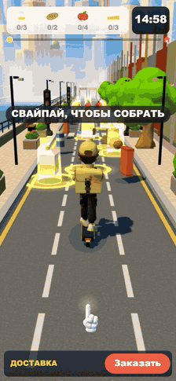
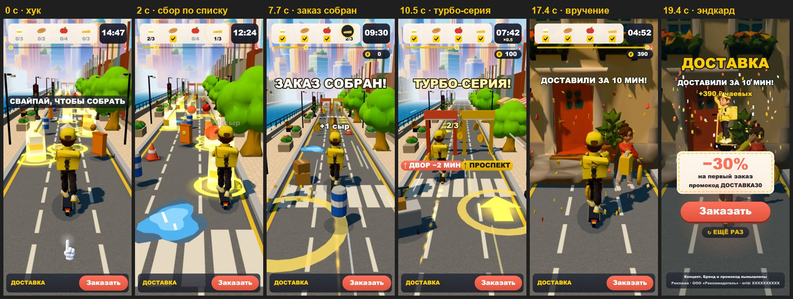
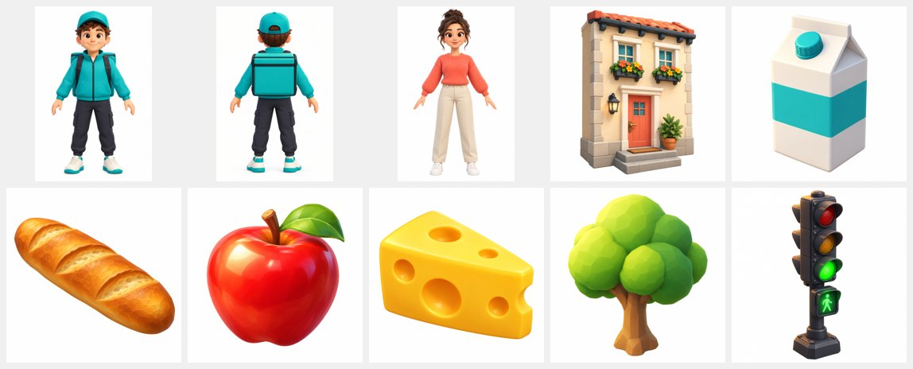

# Доставка — 3D playable ad, собранный ИИ-пайплайном

**▶ Играть в браузере / с телефона:** https://bankaino.github.io/delivery-runner-playable/
(A/B-варианты: [short_list](https://bankaino.github.io/delivery-runner-playable/short_list.html) · [free_delivery](https://bankaino.github.io/delivery-runner-playable/free_delivery.html) · [no_timer](https://bankaino.github.io/delivery-runner-playable/no_timer.html))

<p align="center"><br><sub>демо-прогон бота, 21 с · <a href="docs/media/gameplay.mp4">MP4 в лучшем качестве</a></sub></p>

Портретная 3D playable-реклама **сервиса доставки продуктов** (концепт, бренд вымышленный). Курьер на самокате собирает заказ по списку и успевает довезти его вовремя. Реклама продаёт не «игру с логотипом», а то, чем сервис доставки хорош: **ассортимент** (собери заказ из 12 продуктов), **скорость** (часы тикают, «доставили за 10 минут»), **оффер на первый заказ** на эндкарде.

Весь путь от идеи до билдов под рекламные сети пройден с ИИ-инструментами: **Claude Code** (план, код, симуляция, анимация), **Codex / ChatGPT image gen** (концепт-арт, текстуры фасадов, улицы и неба), **Tripo** (3D-модели курьера, клиентки, дома, дерева и светофора из концептов, авториггинг персонажей).



## Что внутри за ~20 секунд

| время (демо-прогон) | бит | что видит игрок |
|---|---|---|
| 0–1.2 с | хук | курьер у даркстора, сверху карточка заказа «молоко 0/3 · хлеб 0/2 · яблоки 0/4 · сыр 0/3», часы 15:00, рука и «СВАЙПАЙ, ЧТОБЫ СОБРАТЬ». В рекламном режиме до первого касания «призрачный палец» сам ведёт курьера |
| 1.2–7.7 с | сбор | нужные продукты стоят на жёлтых светящихся кольцах «змейками» через полосы; ряд никогда не начинается в той полосе, где кончился предыдущий, а на ней стоит препятствие — по прямой не собрать. Каждый подобранный продукт летит в свою ячейку списка, счётчик «2/3» щёлкает. Лишний товар (чипсы, газировка) — «−30 СЕК», часы трясёт |
| 7.7 с | заказ собран | «ЗАКАЗ СОБРАН!», вспышка, турбо на 3 с с плавным затуханием, FOV-удар, линии скорости |
| 8–17 с | доставка | скорость растёт до самой двери; по полосам — дорожки монет-чаевых (счётчик «₽»), три цепочки стрелок-бустеров («ТУРБО-СЕРИЯ!» — часы идут вдвое медленнее), развилка «↑ ДВОР −2 МИН / ↑ ПРОСПЕКТ». Слева набережная с рекой, справа витрины с маркизами |
| 17.4 с | вручение | дом в конце улицы, клиентка протягивает руку и забирает пакет, конфетти, «ДОСТАВИЛИ ЗА 10 МИН!» |
| 19.4 с+ | эндкард | название, итог чаевых, курьер машет, купон «−30% на первый заказ», «Заказать» (весь экран — CTA), «Ещё раз», юридический блок |

**Машин в игре нет совсем.** Курьер на самокате рядом с машинами — плохой пример безопасности, поэтому улица условная, без транспорта, а светофоры — декор, всегда зелёные.

Принципы из практики плейаблов: хук ≤ 3 с одним пальцем; первая награда ≤ 2 с; **кнопка «Заказать» видна всё время**; на каждое действие — отклик (кольца, частицы, полёт предмета в список, тряска, звук); жёсткого проигрыша нет — опоздал, значит другой эндкард («ПОЧТИ УСПЕЛИ!» и бесплатная доставка вместо скидки). Эндкард гарантирован всем: 12 с без касаний, 10 с простоя, 28 с максимум.

## 3D-модели: от концепта до 50 KB

| модель | путь | треугольники | вес в билде |
|---|---|---|---|
| курьер (со скелетом) | концепт в Codex → Tripo image-to-3D + авториг | 10.5k → 7k | 277 KB |
| клиентка (со скелетом) | концепт в Codex → Tripo + авториг | 9.2k → 4k | 90 KB |
| дом клиентки | концепт в Codex → Tripo | 8.9k → 2.9k | 108 KB |
| дерево | концепт в Codex → Tripo | 25k → 1.7k | 48 KB |
| светофор | концепт в Codex → Tripo | 23k → 2k | 55 KB |
| самокат, продукты, препятствия, улица | процедурно в коде | — | 0 KB |



Модели из Tripo приходят тяжёлыми (2–3.5 MB, текстуры 2048 px): FBX переводится в GLB в headless-браузере (`tools/fbx2glb/`), затем сетка прореживается, текстура уменьшается до 384–512 px и всё сжимается meshopt. **Анимаций в моделях нет — все позы считаются в коде**: двухзвенная IK ставит руки курьера на руль, ноги на деку, толкает задней ногой от асфальта, протягивает пакет и машет ладонью к зрителю; клиентка берёт пакет одной рукой и держит его у бока.

## Билды под рекламные сети — одной командой

```bash
python tools/build_playable.py --variant all
```

Каждый билд — **один HTML-файл** без внешних запросов: three.js (tree-shaken), код, модели, текстуры (WebP) и адаптер сети.

| сеть | размер | лимит | CTA / жизненный цикл |
|---|---|---|---|
| AppLovin | 1.78 MB | 5 MB | MRAID `mraid.open` |
| Unity Ads | 1.78 MB | 5 MB | MRAID |
| ironSource | 1.78 MB | 5 MB | DAPI `openStoreUrl` |
| Mintegral | 1.78 MB | 5 MB | `install()`, `gameReady()`, `gameEnd()` |
| Google Ads | 0.89 MB (zip) | 5 MB | `ExitApi.exit()` |
| Meta | 1.78 MB | 2 MB | `FbPlayableAd.onCTAClick()` |

Звук процедурный (WebAudio, 0 байт): «дзынь» на подборе с повышением тона, звон монет, свип турбо, звонок в дверь. Стартует только после первого касания и выключается, когда реклама не видна. Полный отчёт: [docs/build-report.md](docs/build-report.md). **Ссылки на сторы в `tools/build.json` — заглушки.**

## Производительность

- 60–61 FPS на мобильном вьюпорте 390×844, 27–47 draw calls, 98–117k треугольников в кадре.
- Деревья, светофоры, продукты, монеты и эффекты — инстансинг (один draw на вид); город — одна слитая сетка + атлас из 8 нарисованных фасадов.
- Рисуется только то, что в зоне видимости; деревья не отбрасывают тени (−50 % треугольников теневого прохода).

## A/B-гипотезы

Вариант = JSON с гипотезой и переопределением параметров (`variants/*.json`), билдится той же командой. Цифры — модель из 300 «казуальных» игроков (`tools/casual.mjs`):

| вариант | гипотеза | вовремя | весь заказ собран |
|---|---|---|---|
| `default` | 12 продуктов, часы, скидка −30 % | 64 % | 29 % |
| `short_list` | 9 продуктов: «ЗАКАЗ СОБРАН!» на 5.8 с вместо 7.7 — досматривают ли чаще до эндкарда? | 74 % | 77 % |
| `free_delivery` | та же игра, другой оффер: бесплатная доставка первого заказа против −30 % | 64 % | 29 % |
| `no_timer` | без часов и давления времени — лишний товар только замедляет. Стресс помогает кликам или мешает? | 100 % | 27 % |

## Как проверяется качество

- **Детерминированная симуляция** (`live/sim.js`, 120 Гц): демо-прогон проверяется headless — первый подбор ≤ 2 с, заказ собран в 7–9.5 с, ни одного лишнего товара, доставка в 16–19.5 с с запасом времени, эндкард ≤ 22 с.
- **Модель игроков** (`tools/casual.mjs`, профили `casual` и `good`): 300 ботов с реакцией, шумом прицеливания и ошибками; баланс подбирается числами, а не на глаз (casual: 64 % вовремя, good: 98 %).
- **Smoke-тест** (`tools/smoke_test.mjs`): собранный HTML в мобильном вьюпорте с заглушкой MRAID — нет ошибок и внешних запросов, CTA вызывает `mraid.open`, эндкард появляется сам, FPS ≥ 50.
- **QA HUD**: каждый экран рендерится в 14 состояниях, проверяются выход текста за экран и наложения.

Весь пайплайн — от референса до билдов — пройден **собственными скиллами для Claude Code**.

## Запуск локально

```bash
python -m http.server 8000      # из корня репозитория
# http://localhost:8000/live/index.html?ad=1  — живая версия (рекламный режим)
# http://localhost:8000/live/index.html       — авто-демо (attract), любое касание — играть
python tools/build_playable.py --variant all --pages docs   # билды + демо для GitHub Pages
node tools/smoke_test.mjs dist/default/applovin.html        # нужен Playwright
node tools/casual.mjs --profile good                         # модель игроков
```

## Структура

```
live/            игра: sim.js (правила), scene.js (3D-мир, IK-позы), hud.js, audio.js, kit.js, модели и текстуры
tools/           build_playable.py, build.json, smoke_test.mjs, casual.mjs, beats.mjs, shot.mjs, record_media.mjs
tools/fbx2glb/   перевод моделей из Tripo (FBX / meshopt GLB) в GLB и превью
variants/        A/B-гипотезы
art/             style bible и промпты для Codex
docs/            демо для GitHub Pages, медиа, отчёт по билдам
licenses/        лицензии сторонних библиотек
```

*Концепт. Бренд, промокод и юридический текст на эндкарде вымышлены (erid — заглушка); ссылки на стор — заглушки. 3D-модели сгенерированы автором в Tripo из своих концептов, весь остальной арт — сгенерирован в Codex или процедурный.*
